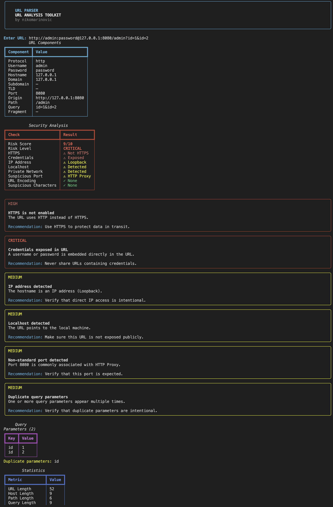
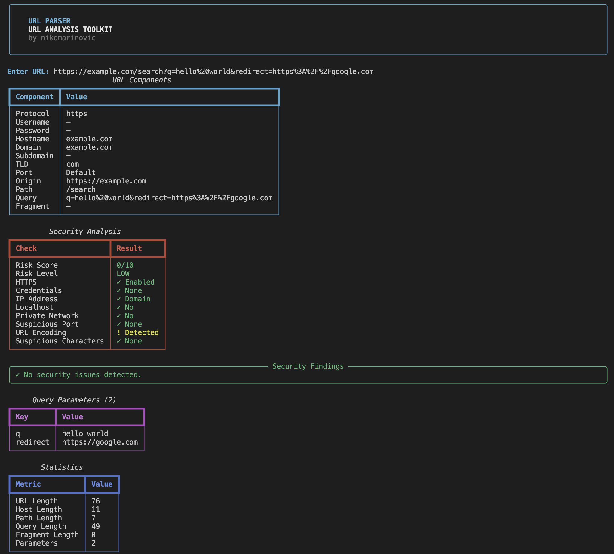
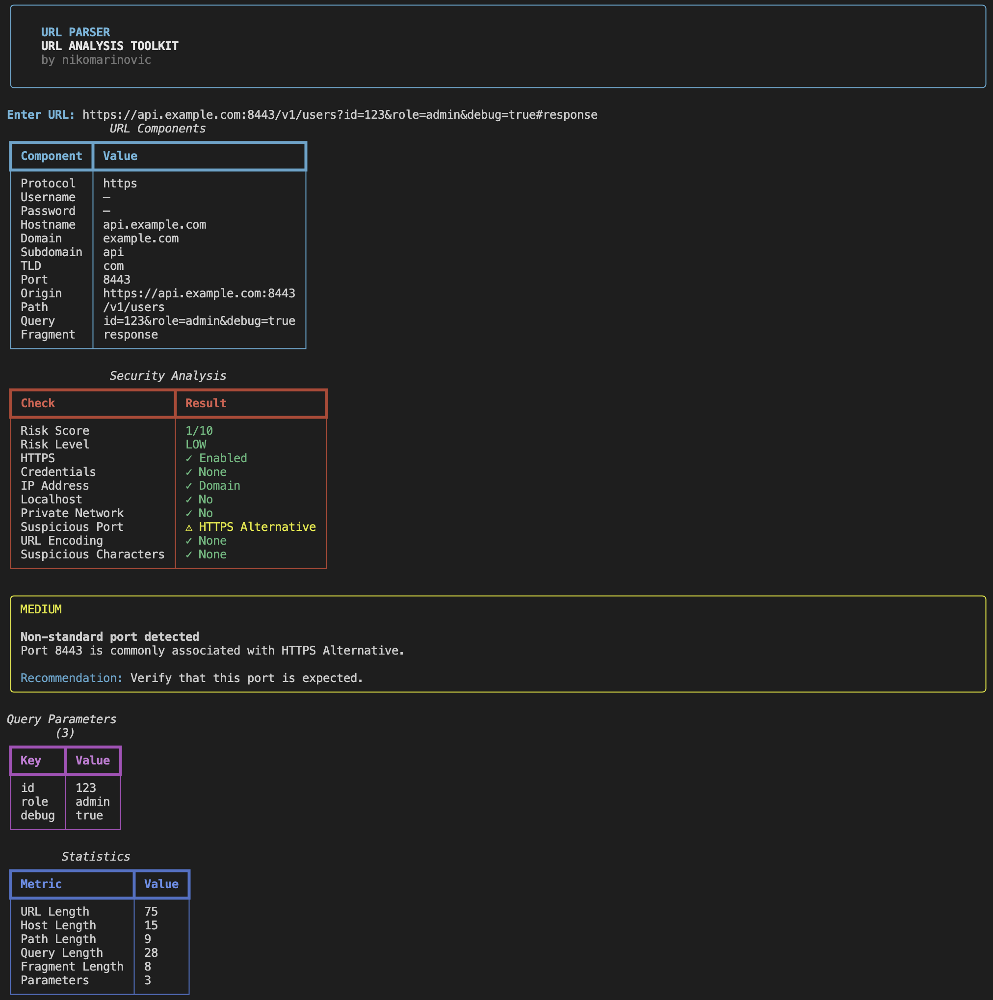

<h1 align="center">
  
  <br />
  URL Parser
</h1>

<p align="center">
  A powerful Python-based URL parsing, analysis, normalization, and security inspection toolkit for developers and security researchers.
</p>

---

## What is URL Parser?

**URL Parser is a lightweight but powerful toolkit for breaking down, analyzing, and inspecting URLs:**

- Parse complete URLs into individual components
- Analyze query parameters, duplicates, and empty values
- Detect potential URL security issues and calculate a risk score
- Encode, decode, and normalize URLs
- Generate machine-readable JSON analysis reports

**`Built as a fast, modular, terminal-based URL intelligence and security analysis toolkit.`**

---

## How It Works

Getting started with URL Parser is fast:

1. **Enter a URL** — Provide a complete URL or a hostname/path without a scheme.
2. **Parse the URL** — URL Parser extracts the protocol, hostname, domain, port, path, query, fragment, and other components.
3. **Analyze the URL** — The toolkit examines query parameters, IP addresses, ports, credentials, encoding, and other characteristics.
4. **Inspect security findings** — A risk score and risk level are generated with detailed findings and recommendations.
5. **Export or process results** — Use JSON output for automation, scripts, reports, or other security tooling.

> [!TIP]
> Use `--json` when integrating URL Parser into scripts or automated security workflows, and `--quiet` when you only need a compact risk summary.

---

## Installation

### macOS

```bash
git clone https://github.com/nikomarinovic/url-parser.git
cd url-parser

python3 -m pip install -r requirements.txt
```

### Linux

```bash
git clone https://github.com/nikomarinovic/url-parser.git
cd url-parser

python3 -m pip install -r requirements.txt
```

### Windows

```bash
git clone https://github.com/nikomarinovic/url-parser.git
cd url-parser

py -m pip install -r requirements.txt
```

---

## Features

- **URL Parsing** — Extract protocol, username, password, hostname, domain, subdomain, TLD, port, origin, path, query, fragment, and full URL.
- **Domain Analysis** — Identify domains, subdomains, TLDs, and direct IP-based hosts.
- **IP Detection** — Detect IPv4/IPv6 addresses and identify public, private, loopback, link-local, and reserved addresses.
- **Security Analysis** — Inspect URLs for potentially risky characteristics and generate security findings.
- **Risk Scoring** — Calculate a `0–10` security risk score and classify URLs as `LOW`, `MEDIUM`, `HIGH`, or `CRITICAL`.
- **HTTPS Detection** — Determine whether a URL uses HTTPS or unencrypted HTTP.
- **Credential Detection** — Detect usernames and passwords embedded directly in URLs.
- **Localhost Detection** — Identify localhost and loopback targets.
- **Private Network Detection** — Detect URLs pointing to private or local network addresses.
- **Suspicious Port Detection** — Identify commonly used ports such as SSH, FTP, RDP, MySQL, PostgreSQL, Redis, HTTP Proxy, and others.
- **URL Encoding Detection** — Detect percent-encoded characters and provide decoded URL information.
- **Suspicious Character Detection** — Flag potentially problematic characters such as `<`, `>`, quotes, backticks, and backslashes.
- **Query Parameter Analysis** — Parse and decode query parameters into individual key/value pairs.
- **Duplicate Parameter Detection** — Detect parameters appearing multiple times in a URL.
- **Empty Parameter Detection** — Identify query parameters with empty values.
- **URL Statistics** — Display URL, host, path, query, fragment, and parameter lengths.
- **URL Encoding** — Encode text using URL encoding directly from the CLI.
- **URL Decoding** — Decode percent-encoded URL data.
- **URL Normalization** — Normalize schemes, hostnames, ports, and paths into a consistent URL format.
- **JSON Output** — Export complete URL, query, security, and statistics information as structured JSON.
- **Quiet Mode** — Return a compact risk summary suitable for scripts and automation.
- **CLI Arguments** — Run individual analysis modules directly from the terminal.
- **Interactive Mode** — Analyze URLs interactively without requiring command-line arguments.
- **Rich Terminal Interface** — Present analysis through structured tables, panels, colors, severity indicators, and readable terminal output.
- **Modular Architecture** — Separate parsing, security, query analysis, encoding, normalization, statistics, and UI functionality.
- **Python Library Support** — Import the parser and analysis components into other Python projects.
- **Testing Support** — Includes a test structure for validating parser functionality and future modules.

---

## Screenshots

<p align="center">
  
</p>

<p align="center">
  
</p>

<p align="center">
  
</p>

---

## Data & Privacy

URL Parser is designed as a local, terminal-based tool. URLs are processed locally by the application and are not uploaded to a remote server by the parser itself.

> [!NOTE]
> URL Parser performs local parsing and static analysis. It does not automatically contact the target website, perform network scanning, or send analyzed URLs to external services.

> [!WARNING]
> URLs can contain sensitive information such as usernames, passwords, tokens, session identifiers, and private query parameters. Avoid sharing sensitive URLs in terminals, screenshots, logs, issue reports, or public repositories.

---

<h3 align="center">
URL Parser does not accept feature implementations via pull requests. Feature requests and bug reports are welcome through GitHub issues.
</h3>

---

<p align="center">
  © 2026 Niko Marinović. All rights reserved.
</p>
